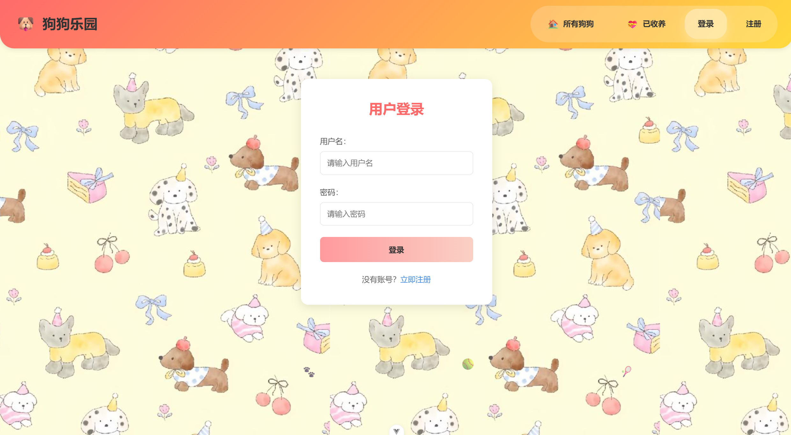
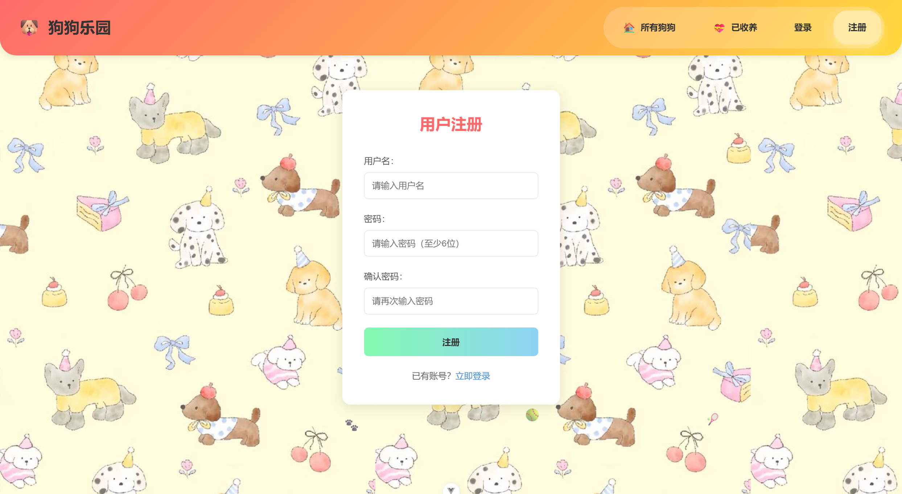
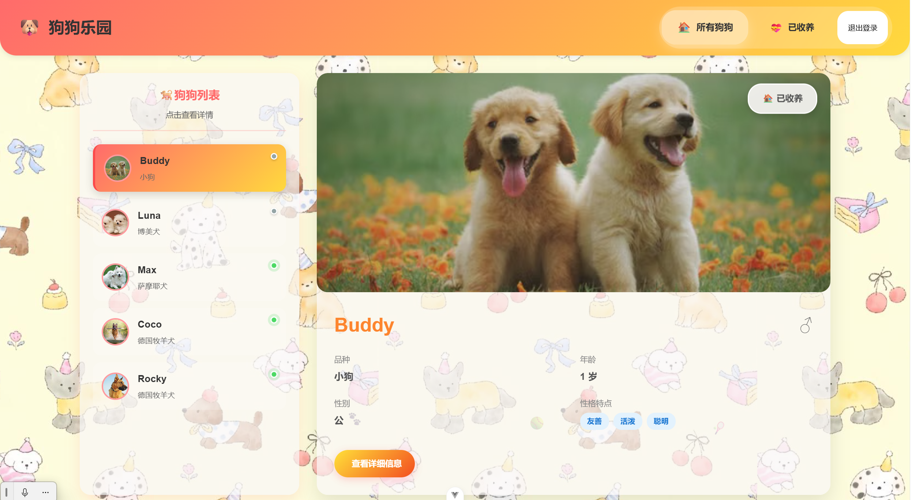
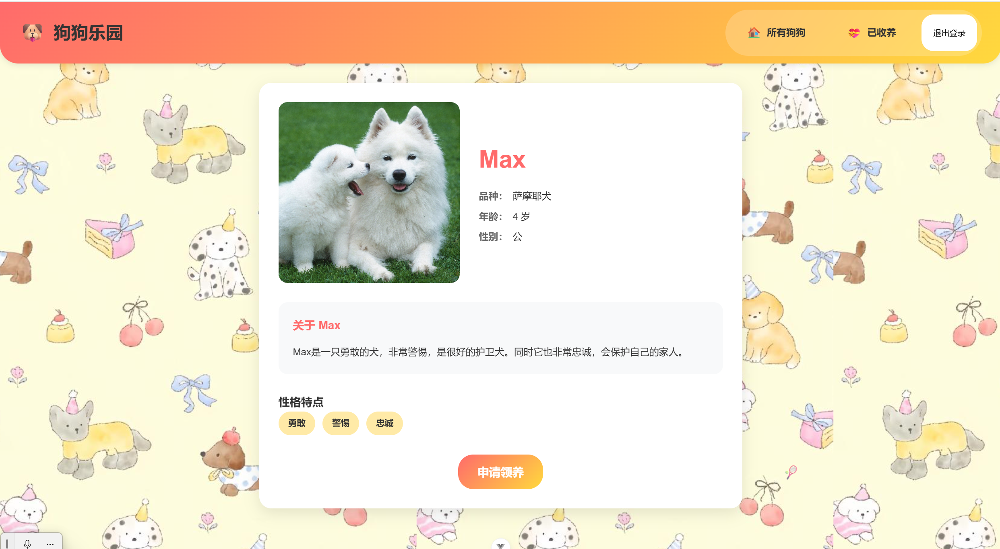
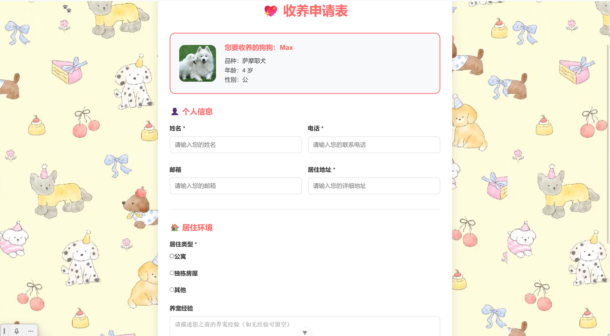
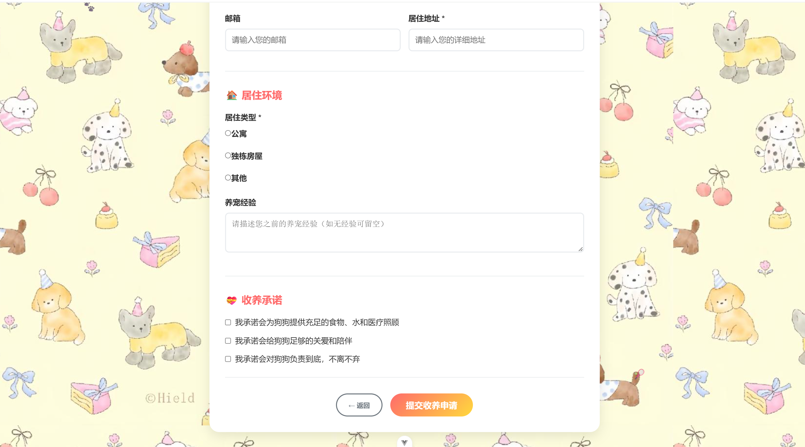
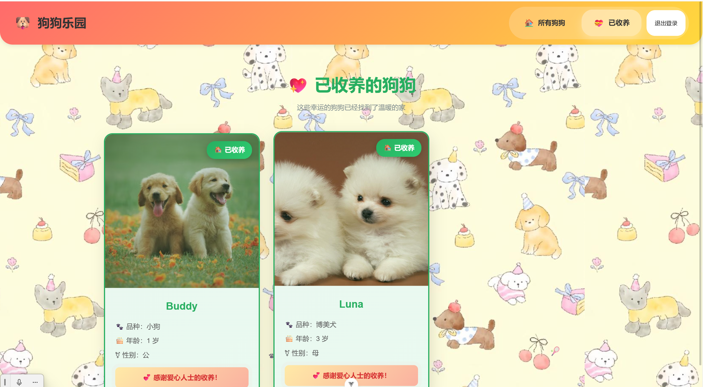

# 宠物领养综合服务平台 (前端)

## 📖 项目简介
本项目是一个基于 Vue3 开发的单页应用（SPA），旨在为流浪动物救助站和爱心人士提供一个信息透明的宠物领养平台。项目包含用户登录注册、宠物列表浏览、详情查看及领养申请提交等完整业务闭环。

## 🛠 技术栈
- **前端框架**: Vue3 (Composition API)
- **构建工具**: Vite
- **路由管理**: Vue Router 4
- **UI 组件库**: Element Plus
- **网络请求**: Axios

## ✨ 核心功能与技术亮点
1. **路由权限控制**: 使用 Vue Router 全局前置守卫 (`beforeEach`) 拦截未登录用户访问敏感页面。
2. **接口请求封装**: 基于 Axios 二次封装，统一处理请求头 Token 携带与 401 响应拦截。
3. **组件化开发**: 抽离公共列表与表单组件，提升代码复用率。
4. **数据状态管理**: 使用组合式 API 的 `ref` 与 `reactive` 管理组件级状态。

## 📸 项目截图展示

### 1. 登录与注册

### 2. 宠物列表与详情

### 3. 领养申请与进度

## 💻 本地运行指南
1. 克隆代码: `git clone https://github.com/Litttt100503/Vue-pet-adoption.git`
2. 安装依赖: `npm install`
3. 启动项目: `npm run dev`
